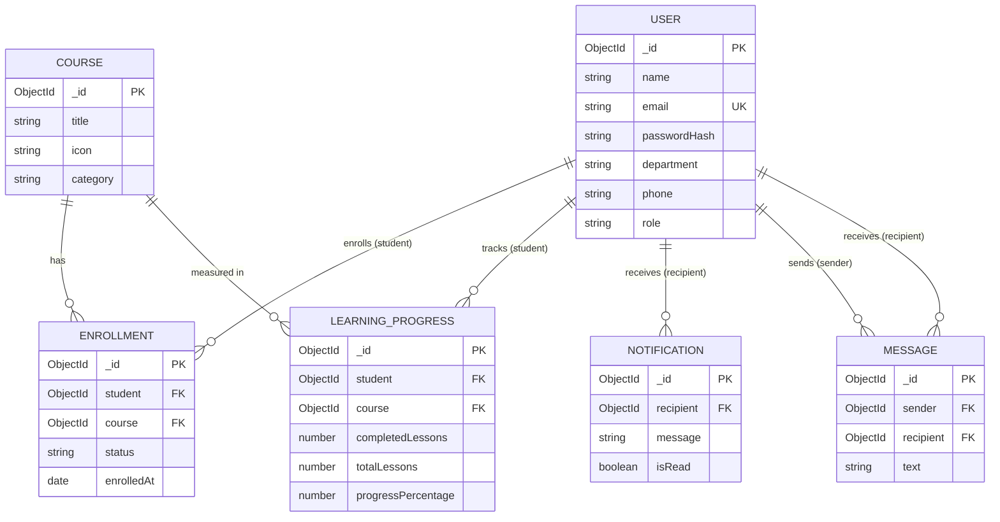

# Database Schema — LMS Portal (Task 11)

**Database:** MongoDB, accessed through Mongoose  
**Database name:** `faceprep_course_system`  
**Connection:** `MONGO_URI` in `backend/.env`  
(`mongodb://127.0.0.1:27017/faceprep_course_system` for local MongoDB; use your Atlas connection string if you use Atlas)

MongoDB automatically generates an `_id` (ObjectId) for every document. All relationships below are stored as ObjectId references (`ref`) and are resolved with `.populate()`.

---

## DATABASE RELATIONSHIPS

*Conceptual relationship diagram. Notifications and chat messages reference users; enrollment and progress reference both users and courses.*



Plain-text version of the same diagram:

```text
                          +-----------+
          +-------------->|   USER    |<--------------+
          |               +-----------+               |
          |                ^    ^    ^                |
          |      student   |    |    | recipient      | sender / recipient
          |                |    |    |                |
   +--------------+  +-------------+  +--------------+  +-----------+
   |  ENROLLMENT  |  |  LEARNING   |  | NOTIFICATION |  |  MESSAGE  |
   | (student,    |  |  PROGRESS   |  | (recipient,  |  | (sender,  |
   |  course)     |  | (student,   |  |  message)    |  | recipient,|
   +--------------+  |  course)    |  +--------------+  |  text)    |
          |          +-------------+                    +-----------+
          |  course        |  course
          v                v
                    +-----------+
                    |  COURSE   |
                    +-----------+
```

### Relationship summary

| Relationship | Type | Implemented by |
|---|---|---|
| User → Enrollment | one-to-many | `Enrollment.student` → `User._id` |
| Course → Enrollment | one-to-many | `Enrollment.course` → `Course._id` |
| User ↔ Course | many-to-many (through Enrollment) | unique `{ student, course }` |
| User → LearningProgress | one-to-many | `LearningProgress.student` → `User._id` |
| Course → LearningProgress | one-to-many | `LearningProgress.course` → `Course._id` |
| User → Notification | one-to-many | `Notification.recipient` → `User._id` |
| User → Message (sent) | one-to-many | `Message.sender` → `User._id` |
| User → Message (received) | one-to-many | `Message.recipient` → `User._id` |

---

## Collections

All schemas use `{ timestamps: true }`, so every document also gets `createdAt` and `updatedAt`.

### 1. `users` — `backend/models/User.js`

| Field | Type | Required | Constraints / default |
|---|---|---|---|
| `_id` | ObjectId | auto | primary key |
| `name` | String | yes | trimmed, max 100 characters |
| `email` | String | yes | **unique**, lowercased, trimmed |
| `passwordHash` | String | yes | bcrypt hash; `select: false` (not loaded unless requested) and removed from JSON output |
| `department` | String | yes | trimmed |
| `phone` | String | no | trimmed, max 20 characters, default `""` |
| `role` | String | no | enum `student` \| `admin`, default `student` |

**Unique index:** `{ email: 1 }`

**Roles:** registration always creates `student`. The only `admin` is created by `npm run seed` (see `backend/seed.js`).

**JSON output:** `_id` is returned as `id` (string); `passwordHash` and `__v` are never returned.

### 2. `courses` — `backend/models/Course.js`

| Field | Type | Required | Constraints / default |
|---|---|---|---|
| `_id` | ObjectId | auto | primary key |
| `title` | String | yes | trimmed |
| `icon` | String | no | trimmed, default `📘` |
| `category` | String | yes | trimmed |

**Indexes:** none besides `_id`.

**JSON output:** `_id` is returned as `id` (string), which is what the React app reads.

### 3. `enrollments` — `backend/models/Enrollment.js`

| Field | Type | Required | Constraints / default |
|---|---|---|---|
| `_id` | ObjectId | auto | primary key |
| `student` | ObjectId → `User` | yes | foreign key |
| `course` | ObjectId → `Course` | yes | foreign key |
| `status` | String | no | enum `active` \| `completed` \| `withdrawn`, default `active` |
| `enrolledAt` | Date | no | default `Date.now` |

**Unique index:** `{ student: 1, course: 1 }` — a student can have only one enrollment record per course.

**Withdrawn status:** unenrolling sets `status: "withdrawn"` instead of deleting the document, so enrollment history is preserved. Because of the unique index, re-enrolling must **reactivate** the withdrawn record rather than insert a new one. See `backend/services/enrollmentService.js` (`enrollStudent`, `withdrawStudent`).

### 4. `learningprogresses` — `backend/models/LearningProgress.js`

| Field | Type | Required | Constraints / default |
|---|---|---|---|
| `_id` | ObjectId | auto | primary key |
| `student` | ObjectId → `User` | yes | foreign key |
| `course` | ObjectId → `Course` | yes | foreign key |
| `completedLessons` | Number | no | min 0, default 0; cannot exceed `totalLessons` |
| `totalLessons` | Number | no | min 0, default 0 |
| `progressPercentage` | Number | no | 0–100, default 0; calculated automatically from the two lesson counts |

**Unique index:** `{ student: 1, course: 1 }` — one progress record per student per course.

### 5. `notifications` — `backend/models/Notification.js`

| Field | Type | Required | Constraints / default |
|---|---|---|---|
| `_id` | ObjectId | auto | primary key |
| `recipient` | ObjectId → `User` | yes | foreign key |
| `message` | String | yes | trimmed, max 500 characters |
| `isRead` | Boolean | no | default `false` |

**Index (non-unique):** `{ recipient: 1, createdAt: -1 }` — fast "latest notifications for this user" queries.

### 6. `messages` — `backend/models/Message.js`

| Field | Type | Required | Constraints / default |
|---|---|---|---|
| `_id` | ObjectId | auto | primary key |
| `sender` | ObjectId → `User` | yes | foreign key |
| `recipient` | ObjectId → `User` | yes | foreign key |
| `text` | String | yes | trimmed, max 2000 characters |

**Index (non-unique):** `{ sender: 1, recipient: 1, createdAt: -1 }` — fast conversation lookups, newest first.

---

## Constraints at a glance

| Collection | Required fields | Unique indexes |
|---|---|---|
| `users` | name, email, passwordHash, department | `email` |
| `courses` | title, category | — |
| `enrollments` | student, course | `{ student, course }` |
| `learningprogresses` | student, course | `{ student, course }` |
| `notifications` | recipient, message | — |
| `messages` | sender, recipient, text | — |

## Notes

- MongoDB does not enforce foreign keys. The `ref` links are an application-level convention; delete handling (for example, what happens to enrollments when a course is deleted) must be done in the service layer.
- Indexes are created by Mongoose (`autoIndex`) when the app connects. Verify them in `mongosh` with `db.enrollments.getIndexes()`.
